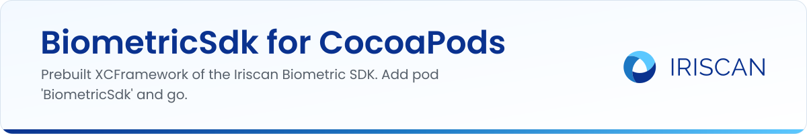

# BiometricSdk CocoaPods release

The iOS binary of the [Iriscan Biometric SDK](https://github.com/biometric-technologies/biometric-sdk), packaged for CocoaPods. CocoaPods is the dependency manager most iOS projects use: you list the libraries you need in a `Podfile`, run `pod install`, and they are downloaded and linked into your Xcode workspace. This repository holds the `BiometricSdk.podspec` and the prebuilt `BiometricSdk.xcframework` that the pod points to. You do not normally clone it; you add one line to your Podfile.

## What it does

- Publishes the SDK as the `BiometricSdk` pod, version 0.6.0 at the moment, for iOS 11.0 and newer.
- Ships the SDK as an XCFramework with two slices: `ios-arm64` for devices and `ios-arm64_x86_64-simulator` for the simulator on Intel and Apple Silicon Macs.
- Declares the one runtime dependency, `TensorFlowLiteObjC` 2.12.0, so CocoaPods installs it for you.
- Links the C++ standard library (`spec.libraries = 'c++'`), which the framework needs at link time.

## How to use it

In your `Podfile`:

```ruby
platform :ios, '11.0'

target 'YourApp' do
  use_frameworks!
  pod 'BiometricSdk', '0.6.0'
end
```

Then run `pod install` and open the generated `.xcworkspace`. In Swift, `import BiometricSdk` gives you `BiometricSdkFactory` and the configuration builders; the API is documented at [docs.iriscan.com/sdk](https://docs.iriscan.com/sdk), and [biometric-sdk-ios-example](https://github.com/biometric-technologies/biometric-sdk-ios-example) is a working app.

## How a release is published

The podspec's `source` points at this repository's git URL with `:tag => '0.6.0'`, and `vendored_frameworks` points at `BiometricSdk.xcframework` in the repository root. A new SDK version is published by building the XCFramework from [biometric-sdk](https://github.com/biometric-technologies/biometric-sdk), committing it here together with a podspec whose `version` matches, and tagging the commit with that version number. Every past version is a tag in this repository, from 0.3.4 to 0.6.0, so `pod 'BiometricSdk', '0.5.12'` keeps working for projects that pin an older release.

## Related repositories

- [biometric-sdk](https://github.com/biometric-technologies/biometric-sdk): the SDK source (Kotlin Multiplatform: Android, iOS, JVM).
- [biometric-sdk-ios-example](https://github.com/biometric-technologies/biometric-sdk-ios-example): SwiftUI app that uses this pod.
- [biometric-sdk-react-native](https://github.com/biometric-technologies/biometric-sdk-react-native): React Native wrapper whose podspec depends on `BiometricSdk`.
- [docs](https://github.com/biometric-technologies/docs): source of the developer documentation at docs.iriscan.com.

## License

License: not yet specified in this repository (there is no LICENSE file). The podspec declares the framework as GPL-3.0, the same license as the SDK source. A commercial license for closed-source products is available: https://www.iriscan.com/commercial-license.

## Contact

info@iriscan.net, https://www.iriscan.com
